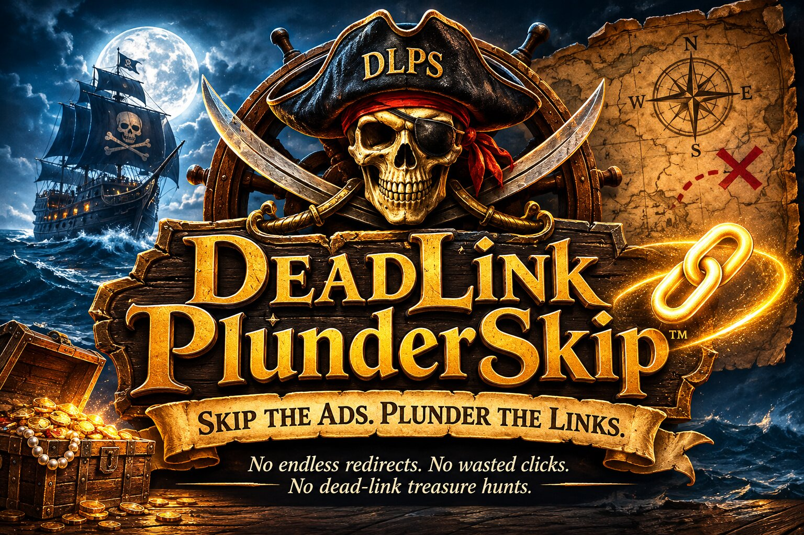
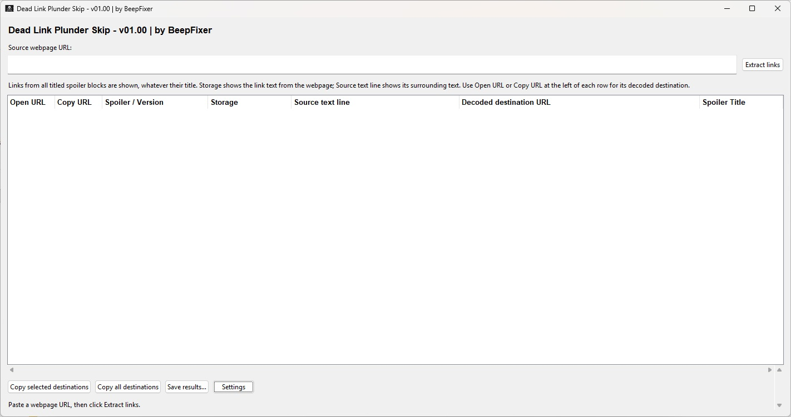

# 🏴‍☠️ DLPS – Dead Link Plunder Skip

**A BeepFixer project · Version 1.0**

*Find the links. Check the loot. Skip the dead ones.*



## Why PlunderSkip?

Like many others, I've recently found myself returning to the good old PS4. With the newer web-based exploits making jailbreaking increasingly accessible, even to users on more recent firmware versions, it seems a lot of people are hopping back onboard and rediscovering the console.

Having recently been asked to service an old PS4 Fat that was absolutely stuffed with dust accumulated over the years, I decided to give it a thorough clean-out. Once it was back in shape, I found myself browsing through DLPS's [huge PS4 game library](https://dlpsgame.com/list-all-game-ps4/).

That got me looking through its catalogue and, in particular, sparked my interest in revisiting older PS4 titles I'd either missed, never got around to playing, or simply left behind in my parents' attic when I moved countries years ago.

It didn't take long, however, to discover that finding working download destinations through DLPS's older webpages can be an exercise in patience. Countless outdated pages, unnecessary redirects, endless sponsor pages and, more often than not, a final destination that turns out to be nothing more than a dead link.

When browsing through a few titles, you'll very quickly notice that some storage providers used years ago simply don't exist anymore. And then there's the ever-so-familiar "Well, looks like we can't go any further." accompanied by MediaFire's little bear on the railway tracks. 

Encountering these dead ends over and over again can get frustrating pretty quickly, so I figured there had to be an easier way: **Dead Link Plunder Skip** was born.

Who knows - perhaps I've just been playing too much Uncharted and started seeing the whole thing as a puzzle challenge. Either way, creating a little vibe-coded pirate utility to extract those links turned out to be a lot more fun than endlessly chasing them manually. 😉



## What does PlunderSkip do?

PlunderSkip is a lightweight Python desktop utility that acts as a little helper tool while browsing DLPS.

Simply copy the DLPS link to a title in their library, paste it into PlunderSkip and hit Enter. It will extract and organise the URLs found on that older webpage, making them much easier to inspect, copy, open or export.

In practice, you'll probably use it to open one destination, discover it's dead, move on to the next, find another dead end, and keep going until you eventually find links that still work.

One important thing to understand: PlunderSkip does NOT verify whether extracted links are alive or dead. It simply collects the available destinations in one convenient place, saving you from having to navigate through the same pages, redirects and sponsor hoops over and over again just to reach them.

## Features

- **URL extraction** – collect URLs found on a DLPS webpage.
- **Open URL** – open extracted destinations directly in your browser.
- **Copy URL** – copy individual URLs to your clipboard.
- **Copy selected** – copy selected results.
- **Copy all** – copy the complete results list.
- **Export results** – save collected results as CSV or TXT files.
- **Customisable columns** – choose which columns are visible and arrange their order.
- **Persistent settings** – retain your preferred application settings between sessions.

**A little tip:** The two functions you're most likely to use are **Open URL** and, especially, **Copy URL**. Both can be useful when working alongside download managers such as JDownloader, allowing you to pass extracted destinations on for further handling.

I won't be going into the specifics of using JDownloader itself, or how individual storage providers may need to be configured or tweaked to work with it. That's a whole other cup of tea! 😉

## A few things worth knowing

PlunderSkip has some limitations, and I'd rather be upfront about them:

- It does **not** eliminate sponsor pages or guarantee that every extracted destination will work.
- It is **not intended to undermine the work or efforts behind newer DLPS releases or recently maintained pages**. PlunderSkip is primarily aimed at older titles and older webpage structures. If DLPS changes how newer releases or download pages work, I have no intention of updating PlunderSkip to accommodate those changes. Any new navigation steps, redirects or hoops introduced will simply have to be handled manually.
- Dead Link Plunder Skip does **not** host, provide or distribute any of the files linked from webpages.

In short, PlunderSkip won't magically make every dead link come back to life. But it can save you from navigating the same maze repeatedly just to discover that the treasure chest is empty: A little pirate tool to skip the pirate booby traps.

## Requirements
The following are required for the initial setup. Once installed, there's no need to repeat this process each time you use PlunderSkip.

- Python 3
- Requests
- Beautiful Soup 4
- Tkinter (usually included with standard Python installations)

## Installation

Setting up PlunderSkip is a one-time process. If you haven't used Python before, don't worry - just follow the steps below.

### 1. Install Python 3

Download the latest Python 3 release from the official [Python website](https://www.python.org/downloads/).

Run the installer and, **if you're using Windows, make sure to tick the "Add Python to PATH" option** before clicking Install. This makes it possible to run Python from the command prompt.

Once installation is complete, Python is ready to go.

### 2. Download PlunderSkip

Download the latest `PlunderSkip.py` file from the [Releases](https://github.com/beepfixer/dlps/releases) section of this repository and save it somewhere convenient on your computer.

### 3. Install the required packages

PlunderSkip needs two additional Python packages: "Requests" and "Beautiful Soup 4".

Press the **Windows key**, type `cmd` and press **Enter**. This will open the Command Prompt. Copy and paste the command below, then press Enter:

```bash
python -m pip install requests beautifulsoup4
```

Press Enter and let the installation finish. You only need to do this once. Once it's done, you can type `exit` and press Enter, or simply close the Command Prompt window.

### 4. Launch PlunderSkip

Locate the `PlunderSkip.py` file you downloaded and **double-click it**. PlunderSkip should launch in its own application window.

**Note:** Depending on your Python installation and Windows settings, a Command Prompt window may also appear alongside PlunderSkip while the application is running. This is normal and can simply be left open.

PlunderSkip should now launch and be ready to use.

**That's it!** The initial setup is complete. From now on, you only need to run PlunderSkip whenever you want to use it.

## Project information

- **Project:** DLPS – Dead Link Plunder Skip
- **Application:** PlunderSkip
- **Current release:** v1.0
- **Language:** Python
- **Interface:** Tkinter
- **Licence:** MIT

## A few personal notes

PlunderSkip is a little tool I mainly built for myself, out of sheer frustration. It also turned out to be a fun way to spend a couple of days exploring what AI could help me achieve, using ChatGPT's free mode credits wisely and patiently waiting through the occasional 24-hour cooldown for another batch. 😄

I haven't spent time optimising the code because, quite frankly, it works as intended. I'm not trying to squeeze every last byte out of it or win any coding competitions. That's something I'd probably be more inclined to do if I were still coding on my C64!

Whether you like AI or hate it, I honestly don't mind either way. For me, this was simply a fun little project and an opportunity to better understand how AI can add value by helping solve a real-world annoyance. I'm happy with the result, so I decided to share it with anyone else who might find it useful. I don't intend to actively promote it beyond mentioning it once on Reddit.

And if anyone involved with DLPS happens to be reading this, I genuinely appreciate the work you've put into the site, and I hope you take no offence at me releasing this little utility.

As a user, it's frustrating to browse through older pages, encounter dead links and then see countless Reddit posts along the lines of "it doesn't work". At the same time, I completely understand that nobody in their right mind would want to manually revisit thousands of old pages just to update outdated links. This little project felt like a reasonable workaround — a bit of a band-aid, perhaps, but surely better than being another person moaning about dead links on Reddit.

I'm also not planning to update PlunderSkip if the way links are presented or accessed on DLPS changes in the future. It was built around the older page structures, and that's where it'll stay.

And on a final note, after all the testing I've done, I've probably clicked through more banners and seen more sponsor pages and adverts than I ever cared to. So at least I've done my share! 😂

## Disclaimer

Dead Link Plunder Skip (PlunderSkip) is provided for informational and personal utility purposes only.

PlunderSkip simply extracts and organises URLs found on webpages. It does not host, store, provide or distribute any files, nor does it bypass access restrictions, remove sponsor pages or guarantee that extracted links are safe, legal or functional.

Users are solely responsible for how they use PlunderSkip and for ensuring that their activities comply with applicable laws, copyright requirements and the terms of service of any websites or services they access.

BeepFixer does not endorse or encourage copyright infringement, unauthorised distribution of copyrighted material or any other unlawful activity.

The software is provided "as is", without warranties of any kind. See the accompanying MIT licence for the full warranty and liability disclaimer.

---

**DLPS – Dead Link Plunder Skip · v1.0**

*By BeepFixer* ☠️
